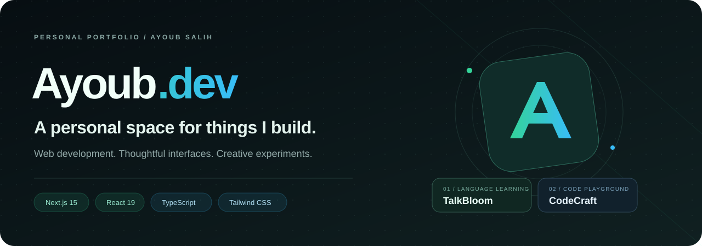
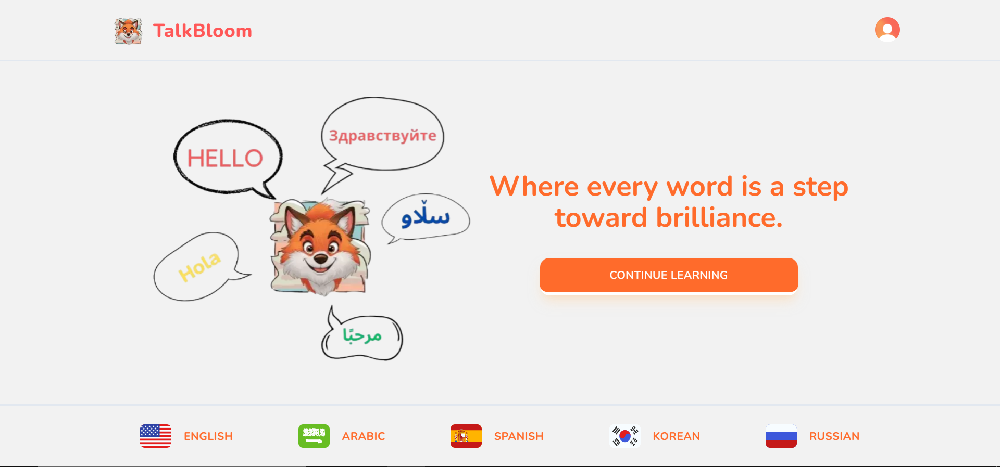
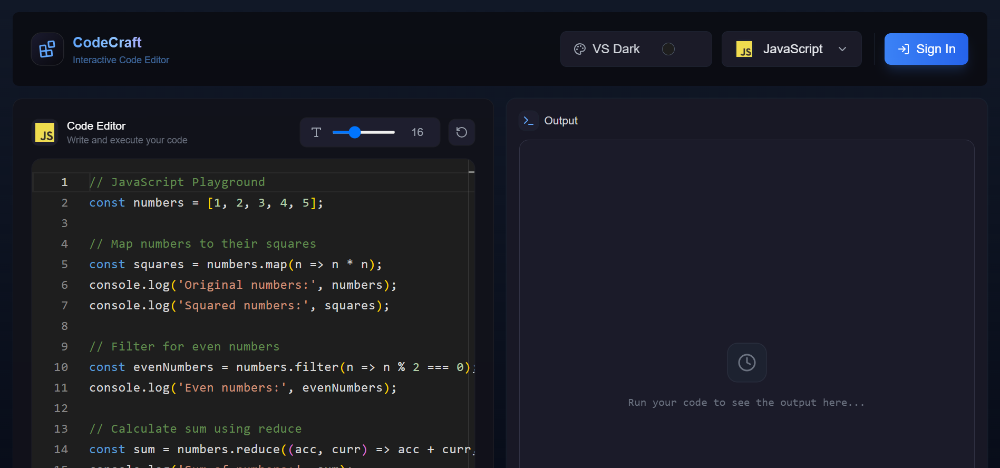

<p align="center">
  
</p>

<p align="center">
  <strong>The source behind Ayoub Salih's personal portfolio.</strong><br />
  A showcase of projects, web development skills, and interactive interface design.
</p>

<p align="center">
  <a href="https://ayoubdev-sepia.vercel.app"><strong>Visit the portfolio ↗</strong></a>
  &nbsp; · &nbsp;
  <a href="#featured-work">Featured work</a>
  &nbsp; · &nbsp;
  <a href="#run-locally">Run locally</a>
  &nbsp; · &nbsp;
  <a href="https://github.com/aeubs66">GitHub profile</a>
</p>

<p align="center">
  
  
  
  
</p>

---

## About this portfolio

**Ayoub.dev** brings my work together in a single, scrollable website. It includes an introduction, an about section, a skills overview, selected projects, and ways to get in touch.

The design uses a dark background, emerald-to-cyan accents, translucent cards, and animated interactions. This repository contains the portfolio website; the featured applications have their own source repositories.

## Featured work

<table>
  <tr>
    <td width="50%" valign="top">
      <a href="https://github.com/aeubs66/talkbloomApp">
        
      </a>
      <h3>TalkBloom</h3>
      <p>A language-learning application with interactive lessons, progress tracking, and illustrated stories.</p>
      <p><a href="https://talkbloom.vercel.app">Explore app ↗</a> · <a href="https://github.com/aeubs66/talkbloomApp">View source</a></p>
    </td>
    <td width="50%" valign="top">
      <a href="https://github.com/aeubs66/code">
        
      </a>
      <h3>CodeCraft</h3>
      <p>A browser-based code playground with Monaco Editor, multiple language configurations, and saved execution history.</p>
      <p><a href="https://code-dusky-kappa.vercel.app">Explore app ↗</a> · <a href="https://github.com/aeubs66/code">View source</a></p>
    </td>
  </tr>
</table>

*These are the project preview images bundled with this portfolio, rather than newly captured screenshots.*

## Inside the experience

| Detail | What it adds |
| :--- | :--- |
| **Animated introduction** | Profile imagery, gradient typography, and rotating role text |
| **Section navigation** | Home, About, Skills, Projects, and Contact, with a mobile menu |
| **Scroll awareness** | Active-section indicators, progress tracking, and reveal animations |
| **Custom cursor** | Desktop pointer effects with section-specific accent colors |
| **Project cards** | Preview images, technology labels, source links, and app links |
| **Visual effects** | A loading screen, translucent surfaces, hover effects, and background particles |

## Built with

| Layer | Technologies |
| :--- | :--- |
| Framework | Next.js 15 App Router · React 19 |
| Language | TypeScript |
| Styling | Tailwind CSS · Custom CSS animations |
| Interface | Radix UI primitives · Lucide icons |
| Interaction | React hooks · Intersection Observer · Browser animation APIs |

## Run locally

Use Node.js compatible with Next.js 15 and npm.

```bash
git clone https://github.com/aeubs66/portfolio.git
cd portfolio
npm ci
npm run dev
```

Open [localhost:3000](http://localhost:3000).

The current portfolio does not require API keys or a database. Its content and project links are defined in the source.

| Command | Purpose |
| :--- | :--- |
| `npm run dev` | Start the development server |
| `npm run build` | Create a production build |
| `npm start` | Serve the production build |

<details>
<summary><strong>Development notes</strong></summary>

The checked-in Next.js configuration skips TypeScript and ESLint errors during production builds. A successful build alone does not establish that those checks pass.

A `lint` script is present, but ESLint is not declared in the current package manifest. The local setup and build have not been executed as part of this repository presentation update.

The Contact section includes a form interface without a submission handler or delivery backend. Use the site's direct contact links to reach me.

</details>

## Find your way around

| Location | Contents |
| :--- | :--- |
| [`app/page.tsx`](app/page.tsx) | Portfolio sections, personal content, skills, and project data |
| [`app/layout.tsx`](app/layout.tsx) | Root document and page metadata |
| [`app/globals.css`](app/globals.css) | Main styling, effects, and animations |
| [`components/custom-cursor.tsx`](components/custom-cursor.tsx) | Custom pointer behavior |
| [`components/loading-screen.tsx`](components/loading-screen.tsx) | Introductory loading experience |
| [`components/scroll-progress.tsx`](components/scroll-progress.tsx) | Scroll indicators and section navigation |
| [`components/ui/`](components/ui) | Shared interface primitives |
| [`public/`](public) | Profile images, project previews, and static assets |

## Connect

Explore my work on [GitHub](https://github.com/aeubs66), or visit [Ayoub.dev](https://ayoubdev-sepia.vercel.app) for project links and contact details.

For issues with this website, [open a repository issue](https://github.com/aeubs66/portfolio/issues) with the page, browser, and steps needed to reproduce the problem.

---

<p align="center">
  <strong>Built to introduce the person behind the projects.</strong><br />
  <a href="https://ayoubdev-sepia.vercel.app">Explore Ayoub.dev ↗</a>
</p>
